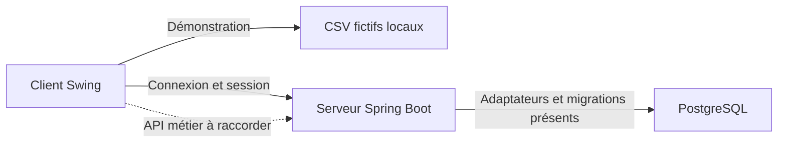

# Gestion+ · Serveur

## Raccordement Swing réalisé, limites de reprise ouvertes — 22 novembre 2026

Le client **`ff68060`** raccorde désormais le parcours MFA restreint : réponse d’activation et preuve éventuelle, dialogue automatique, contexte/cookies/CSRF, clé masquée affichable, confirmation TOTP et présentation unique des dix codes. Transfert de responsabilité de la connexion entre contrôleurs, retour à la connexion normale avec nouveau TOTP, **sans connexion automatique ni accès métier**.

La mention « formulaire Swing à développer/raccorder » ci-dessous est historique. Voir le [suivi client courant](https://github.com/lisepinheiro2-lgtm/gestionplus-client/blob/main/docs/VALIDATION.md#mfa-swing-2026-11-22) pour **443/443 client dans chaque mode**, les quatre scénarios intégrés, les deux écrans en clair/sombre et les douze empreintes recoupées. Serveur de recette **`4a71440`**, identique au HEAD local relu ; la suite serveur complète **n’a pas été relancée**. Ses **1 191/1 191** appartiennent à la validation précédente, pas à ce raccordement.

Recette avec vrai Spring Boot et PostgreSQL/Redis jetables, mais **SMS simulés et HIBP remplacé**, aucun appel Free/OVHcloud ni SMS réel. Environnement arrêté et conteneurs supprimés selon le rapport. Aucun déploiement ou réception réelle validé.

**Ne pas considérer l’étape MFA entièrement close :** après perte/expiration du contexte, le serveur n’offre pas encore une reprise autonome avec une nouvelle preuve vérifiée. L’orientation vers l’administrateur n’ajoute aucun mécanisme administratif de reprise. Si la réponse de confirmation contenant les codes est perdue, le client ne peut pas les relire ; il présente un résultat incertain et ne répète pas automatiquement le TOTP. Ces limites restent à traiter ou à accepter explicitement. Aucun code serveur, test, configuration ou migration modifié par cette mission documentaire ; aucun test, build, serveur ou migration exécuté.

**Jalon antérieur au raccordement MFA Swing du 22 novembre : les dates, résultats et anciennes limites ci-dessous restent historiques ; lire la reprise ci-dessus pour l’état courant.**

## Enrôlement MFA restreint côté serveur — 22 novembre 2026

Sur **`51407e3`**, une preuve unique ouvre un contexte d’enrôlement de **dix minutes absolues**, distinct d’une session métier. Rotation de session/CSRF, contrôle compte/version/expiration, sérialisation JSON restreinte, indexation et révocation Redis sont présents. Les requêtes et begin répétés ne prolongent pas l’échéance.

POST `/api/auth/mfa/enrollment/session` consomme la preuve et répond 204 ; POST `/api/auth/mfa/enrollment` prépare ou restitue l’enrôlement valide ; POST `/api/auth/mfa/enrollment/complete` confirme le facteur, retourne les codes de secours et ferme le contexte. Connexion normale avec mot de passe et **nouveau TOTP** ensuite : le code de confirmation est déjà consommé, aucune promotion automatique ni accès métier depuis ce contexte.

Confirmation limitée à **cinq soumissions par compte/dix minutes**, partagées via Redis et indépendantes des rollbacks. Ouverture incluse dans le quota public commun de **30 requêtes par IP/quinze minutes**. Dépassement en 429 avec `Retry-After` ; CSRF conservé, refus 403 `FORBIDDEN` (`CSRF_REJECTED` est la raison d’audit). V29 stocke les preuves ; V30 ajoute l’index unique sur `proof_hash`.

**Codex : suite complète serveur 1 191/1 191**, dont 14 scénarios à deux JVM, sans échec/erreur/test ignoré. Les 25 fichiers inventoriés correspondent au rapport établi avant commit sur le socle `e5f3434`. PostgreSQL/Redis jetables, processus/conteneurs arrêtés, aucun SMS réel ni appel fournisseur.

**Formulaire Swing encore à raccorder**, sans nouveau code ni nouvelle validation client. Déploiement réel et réception SMS non validés. Voir [contrat, preuves et limites](docs/AVANCEMENT.md#mfa-restreint-2026-11-22) et [guide développeur](docs/DEVELOPPEMENT.md#mfa-restreint-2026-11-22). Aucun test, build, serveur ou migration exécuté par cette mise à jour.

**Historique antérieur à la reprise MFA du 22 novembre : les résultats, décisions et anciennes limites ci-dessous gardent leur date et leur périmètre.**

## Activation SMS sécurisée et client Swing — 21 novembre 2026

**Serveur `165d2e0`, client `ec08c42`.** La création du défi SMS revalide compte/invitation sous verrou PostgreSQL, reprend le téléphone verrouillé et relit l’heure ainsi que l’empreinte du jeton avant insertion. Transaction englobante explicitement refusée ; envoi après commit et échec initial préservé si la révocation compensante échoue.

**V28** ajoute `send_confirmed_at` et `send_recovery_at`. Sans confirmation, le défi n’est pas utilisable. La reprise révoque les envois non confirmés à échéance, au démarrage puis périodiquement, par lots PostgreSQL avec `FOR UPDATE SKIP LOCKED`. Aucun renvoi automatique ; historique et quota conservés. V28 révoque aussi les anciens défis ouverts, sans supprimer leurs lignes.

Adaptateur **OVHcloud SMS EU**, sans dépendance ajoutée, activé par `gestionplus.sms.provider=ovh`, avec paramètres externes et exclusivité vis-à-vis du fictif/Free. Délais et réponses bornés, redirections refusées et erreurs génériques ; Free reste destiné aux essais locaux. Le formulaire Swing est raccordé, avec demande explicite de SMS et retour à la connexion sans connexion automatique.

**Validation antérieure de Codex : 1 143/1 143 serveur**, dont 12 scénarios à deux JVM, et **413/413 client dans chaque mode**. PostgreSQL/Redis jetables, expéditeur et appels fournisseur simulés ; processus/conteneurs arrêtés. Aucun compte OVHcloud réel, appel réel ou SMS facturé. **Confirmation d’envoi signifie acceptation fournisseur, pas réception sur téléphone.**

Voir [code, résultats et limites](docs/AVANCEMENT.md#activation-sms-swing-2026-11-21), [configuration OVHcloud et profil test Testcontainers](docs/DEVELOPPEMENT.md#activation-sms-swing-2026-11-21) et [préparation de V28](docs/PUBLICATION.md#activation-sms-swing-2026-11-21). Réception réelle, premier enrôlement TOTP et déploiement restent ouverts ; aucune recette complète Swing → OVHcloud → téléphone revendiquée. Aucun test, build ou lancement effectué par cette mise à jour.

**Historique antérieur à cette reprise activation SMS/Swing : les dates, preuves et anciennes limites ci-dessous gardent leur contexte ; la reprise ci-dessus décrit l’état courant.**

## Fonctionnement multi-instance — 21 novembre 2026

**État relu : `f4c6931`.** La conception multi-instance remplace la décision antérieure de premier déploiement sur une seule instance. Spring Session Data Redis partage sessions et CSRF ; registre, révocations, activité de session et limitation des connexions utilisent Redis commun. Les mises à jour d’activité sont monotones et une requête terminée après logout ne rétablit pas la session. JSON limité à des types explicitement autorisés, cohérence des clés vérifiée entre instances et profil `reverse-proxy` à proxies de confiance explicites.

Une sécurité partagée indisponible entraîne un **503**, sans repli local silencieux en production. Le contrat `RequestRateLimiter.acquire(scope, address, limit, window)` est prêt pour le filtre public développé séparément par Lise ; **le filtre public est absent du commit `f4c6931` ; un squelette local de Lise est apparu pendant cette mission, sans filtrage HTTP raccordé au contrôle**.

**Validation antérieure de Codex : 291/291 tests ciblés sur 23 classes**, dont dix scénarios HTTP sur deux JVM et Redis/PostgreSQL jetables. Les anciens MockMvc utilisent une configuration servlet simulée réservée aux tests. Suite complète non exécutée, aucun nouveau total global. Benchmark compilé seulement : aucune nouvelle mesure. Aucune migration ajoutée, aucun SMS réel envoyé pendant ces validations ; services d’essai arrêtés.

Voir [code, attributions et limites](docs/AVANCEMENT.md#multi-instance-2026-11-21) et [configuration externe Redis, TLS, clés et audit par instance](docs/DEVELOPPEMENT.md#multi-instance-2026-11-21). Redis Cluster, haute disponibilité complète, reverse proxy réel et infrastructure de production ne sont pas validés. Aucun test, build, serveur ou migration lancé pendant cette actualisation documentaire.

**Jalon antérieur au lot multi-instance du 21 novembre : lire la reprise ci-dessus pour l’état courant et les décisions remplacées.**

## Structures autorisées et revue — 21 novembre 2026

État local relu **`72aa7f4`**, après `1ce0561` et `63046e8`. GET authentifiés **`/api/structures`** et **`/api/structures/{structureID}`**, réponse limitée à `structureID` et `structureName`. Recherche groupée des candidats, SUPER_ADMIN désigné de l’entreprise pris en compte et autorisations conservées côté serveur. Structures étrangères/inaccessibles : **404 générique** ; autres routes non autorisées refusées par défaut. Aucune nouvelle migration.

Services d’accès aux structures, transfert ADMIN, succession volontaire, désactivation/révocation de sessions et responsabilité MANAGER présents ; parcours HTTP/Swing complets à raccorder. Création/fermeture complète des structures : chantier distinct. Le client suit désormais les sessions et sélectionne les structures autorisées ; ses cartes métier connectées restent désactivées.

HIBP valide les compteurs même sans correspondance d’empreinte, avec traitement en `Long`. Voir [portée exacte, décisions et 13 tâches ouvertes](docs/AVANCEMENT.md#reprise-2026-11-21). Lise rapporte **924/924 serveur sur `63046e8`** avant correction ; Codex **19/19 HIBP** après, client HTTP simulé. « Tout est vert » confirmé ensuite par Lise n’apporte aucun nouveau total. Aucun test, build, serveur ni migration pendant cette actualisation.

## Premier raccordement Swing — 20 novembre 2026

**Historique du 20 novembre ; lire la reprise du 21 novembre ci-dessus pour l’état courant.**

Le client `03387cc` communique réellement avec la connexion/session du serveur `b2ca9e3`. Lise confirme une recette locale avec SUPER_ADMIN fictif et TOTP : connexion, accueil avec identité, déconnexion/reconnexion et maintien de la démonstration autonome.

**284/284 tests client réussis** sont rapportés par Lise. Le dernier résultat serveur reste **900/900 sur `4c630ee` le 19 novembre**. La préparation isolée de l'assistant et ses contrôles HTTP sont [distingués ici](docs/AVANCEMENT.md#connexion-swing-2026-11-20).

Les cartes métier connectées, le suivi Swing de l'expiration et le fournisseur SMS réel restent à développer. Aucun compte ni secret prêt à l'emploi n'est ajouté au dépôt.

**Le chantier backend de Gestion+, une application de gestion du personnel, des clients, des interventions et des remplacements.**

Gestion+ est un projet personnel de portfolio, développé progressivement pour approfondir Java, la conception d'une application de bureau et la construction d'un serveur sécurisé. Il est né d'un client Java Swing qui fonctionne aujourd'hui avec des fichiers CSV locaux. Le premier raccordement de connexion/session est présent ; l'évolution vers les API métier connectées et le stockage centralisé se poursuit.

> **En développement actif — version déclarée : 0.0.1-SNAPSHOT.**
> Les sources sont proposées pour découvrir le travail en cours. Le serveur ne fournit pas encore une application utilisable de bout en bout et n'est pas prêt pour un usage en entreprise ou une exposition sur Internet.

🚀 **[Télécharger et essayer la démo Windows](https://github.com/lisepinheiro2-lgtm/gestionplus-client/releases/tag/v0.1.0-demo)**
*Démonstration du client Swing avec données fictives et stockage CSV local, sans connexion au serveur.*

[Découvrir le client Swing](https://github.com/lisepinheiro2-lgtm/gestionplus-client) · [Avancement et feuille de route](docs/AVANCEMENT.md) · [Guide développeur](docs/DEVELOPPEMENT.md)

## Pourquoi un serveur ?

La cible est de centraliser les données et de vérifier l'identité et les droits de chaque utilisateur avant une opération. Le client présente les écrans ; le serveur porte les règles et les contrôles ; PostgreSQL conserve les données.

Le développement privilégie une séparation lisible entre métier, persistance et interface, ainsi que des validations progressives. La gestion complète des comptes et des permissions reste un chantier.

## Deux dépôts, deux fonctionnements à distinguer

| Élément | Fonctionnement actuel | Cible |
| --- | --- | --- |
| [Client Swing](https://github.com/lisepinheiro2-lgtm/gestionplus-client) | Démo CSV fictive et mode connecté pour identité, accueil et déconnexion. | Raccordement des écrans aux API métier autorisées. |
| Ce serveur Spring Boot | Parcours HTTP de connexion/session et services métier de comptes, permissions et audit en développement. | Intégration complète des services avec Swing et API métier contrôlées. |
| PostgreSQL | Configuration locale et migrations présentes dans les sources ; état réel d'une base non déduit de ces fichiers. | Stockage du serveur, accessible par celui-ci. |

**Consulter ou récupérer ce dépôt ne rend pas Spring Boot obligatoire pour démarrer le client dans son fonctionnement autonome actuel.** Aucun démarrage automatique du serveur n'est ajouté au client. Cette autonomie de démonstration ne constitue pas une autorisation d'accéder hors ligne à des données d'entreprise : les contrôles de l'usage connecté doivent rester imposés côté serveur.

## Ce que l'on peut déjà examiner

- Les modèles de comptes, de credentials, de salariés et d'unités organisationnelles.
- Les services de comptes, d’invitations, de gouvernance, d’authentification et de changement de mot de passe.
- Les contrôles de rôles et de périmètres côté serveur, les sessions et le MFA TOTP.
- Les adaptateurs JPA/JDBC et les migrations V1 à V27 présentes dans les sources, dont le stockage des défis SMS d’activation.
- L’audit transactionnel et son secours chiffré, les files d’envoi et les tests unitaires et PostgreSQL associés.

Au 19 novembre 2026, le dernier état relu est `4c630ee` : expéditeur SMS fictif conditionnel, chemin HTTP partagé, tests avec la vraie chaîne Spring Security et cycle de session. Lise confirme **900/900 tests réussis dans Eclipse** sur cet état ; ce résultat local est rapporté par Lise, sans exécution par l’assistant. [Jalon et portée des preuves](docs/AVANCEMENT.md#securite-http-sessions-2026-11-19)

**Assemblage des tests :** `ActivationMessageSender` est simulé par `@MockitoBean` dans la base commune `AuditStorageIntegrationTest`, héritée par les contextes `@SpringBootTest` actuels. Cette déclaration reste dans `src/test`. L’application fournit désormais `FakeActivationMessageSender`, activé uniquement par `gestionplus.sms.fictif=true` : il journalise le numéro et le code sans envoyer de SMS réel.

**Ordre de raccordement :** l’expéditeur minimal doit être disponible **avant le raccordement serveur–client** ; `FakeActivationMessageSender` couvre ce besoin pour les essais locaux sous activation explicite. Après raccordement, intégrer l’expéditeur SMS réel, valider son intégration avec le vérificateur HMAC et inventorier les autres composants applicatifs provisoires. [État des composants SMS](docs/AVANCEMENT.md#beans-definitifs-apres-raccordement)

**Contrat d’appel :** `requestActivationChallenge(invitationID, token)` et sa délégation à `createChallenge(invitationID)` doivent être appelées **sans transaction Spring déjà active**. Cette précondition est [documentée explicitement](docs/AVANCEMENT.md#contrat-appel-creation-defis-sms) ; elle n’est pas contrôlée automatiquement par les services.

## Accès HTTP présents dans les sources

Configuration HTTP relue le **19 novembre 2026**, sur `4c630ee`. Les routes applicatives actuellement autorisées sont les suivantes :

| Méthode et chemin | Accès et comportement |
| --- | --- |
| `GET /api/auth/csrf` | Accessible sans connexion ; fournit le jeton CSRF et crée la session nécessaire. |
| `POST /login` | Formulaire `application/x-www-form-urlencoded` avec `username`, `password` et, lorsque requis, `totp`. Jeton CSRF obligatoire. Succès : 200 ; échec d’authentification : 401 générique. |
| `GET /api/auth/me` | Session authentifiée encore valide ; renvoie le nom d’utilisateur courant. |
| `GET /api/auth/session` | Session authentifiée ; renvoie `expiresAt` et `warnAt`. Cette consultation ne prolonge pas l’activité. |
| `POST /logout` | Jeton CSRF obligatoire ; déconnexion et réponse 204. |
| `POST /api/invitations/{invitationID}/sms-challenge` | Accessible sans connexion avec session et jeton CSRF ; invitation et jeton d’invitation vérifiés par le service. Succès MVC : 200 sans corps. |

La configuration `formLogin` conserve les pages HTML par défaut de Spring Security pour `GET /login` et la confirmation `GET /logout`. Ces pages ne constituent pas le parcours Swing avec MFA. Le traitement interne des erreurs servlet est autorisé ; les autres routes restent refusées par défaut.

Les services d’invitation, d’activation, d’enrôlement et récupération MFA, de changement de mot de passe et de gouvernance existent côté Java. **En dehors des accès décrits ici, leurs points d’entrée HTTP et leur intégration Swing restent à construire.** Le traitement d’un conflit de nom à l’activation est préparé en 409 générique, sans détail sur un autre compte ; les autres contraintes PostgreSQL ne sont pas assimilées indistinctement à ce conflit.

### Demande de code SMS par HTTP

Le commit `48465e5` déclare `POST /api/invitations/{invitationID}/sms-challenge` avec un UUID dans le chemin et un corps `application/json` de la forme `{"token":"…"}`. Le contrôleur délègue au service avec cet UUID et ce jeton. Spring MVC renvoie `200` avec un corps vide en cas de succès. [Contrôleur de demande de code SMS](src/main/java/fr/gestionplus/server/api/AccountActivationController.java)

Le traitement MVC renvoie `400 INVALID_REQUEST` pour un UUID invalide ou un corps JSON absent ou mal formé, `403 FORBIDDEN` pour un refus métier avec authentification, `409 CONFLICT` pour un conflit de création du défi et `503 SERVICE_UNAVAILABLE` pour une livraison d’invitation en attente ou une indisponibilité reconnue. Le même refus métier sans authentification donne `401 AUTHENTICATION_REQUIRED`. La chaîne Spring Security autorise ciblément ce POST anonyme ; CSRF reste obligatoire. Sans jeton CSRF, le refus est 403 avant le service. Le chemin est partagé via `AccountActivationRoutes.SMS_CHALLENGE_PATH`. [Tests avec les vrais filtres](docs/AVANCEMENT.md#securite-http-sessions-2026-11-19) · [Traduction des erreurs MVC](src/main/java/fr/gestionplus/server/api/ApiExceptionHandler.java) · [Jalon de la route SMS](docs/AVANCEMENT.md#route-demande-code-sms-2026-11-18)

## Migrations présentes et état de la base

Les sources contiennent **V1 à V27** :

| Versions | Objet |
| --- | --- |
| V1–V6 | Comptes, credentials, salariés et unités organisationnelles. |
| V7–V12 | Audit, structures et rôles locaux, unicité ADMIN, entreprises, appartenances administratives et métadonnées d’audit. |
| V13–V16 | Identité des comptes, association unique au salarié et périmètres des salariés/unités. |
| V17–V18 | Cohérence des appartenances entreprise/structure, version de session et responsabilités des managers. |
| V19–V21 | Files de notifications et invitations d’activation. |
| V22–V23 | Entreprise de l’audit, journal transactionnel chiffré, réintégration et facteurs TOTP/codes de récupération. |
| V24 | Contrôle des rattachements historiques et validation des contraintes ajoutées en V17. |
| V25 | Demandes durables d’envoi des invitations, états et nouvelles tentatives. |
| V26 | Compteur de tentatives des notifications de désactivation ; le service borne les essais avant abandon audité. |
| V27 | Stockage des défis SMS d’activation, empreinte du code, échéance, échecs, consommation, révocation et unicité du défi courant par compte/invitation. |

La présence de ces fichiers **ne prouve pas leur application sur une base**. V24 refuse des rattachements historiques incohérents et n’invente aucun droit pour les réparer. L’état réel de Flyway, les sauvegardes et toute correction des données doivent être vérifiés sur la base explicitement choisie avant une montée de version. Les migrations déjà publiées ou appliquées ne sont pas réécrites.

## Protections implémentées et limites

- Autorisations côté serveur et isolation entreprise/structure, avec rôles courants relus et contrôle de la version de session.
- SECRETARY peut gérer les comptes EMPLOYEE et TEAM_LEAD autorisés de sa structure ; les comptes privilégiés et les autres périmètres restent protégés. La création d’un compte en attente exige un salarié pour tous les acteurs, avec les contrôles de périmètre propres à chacun.
- SECURITY_OFFICER est déclaré et soumis au MFA. La décision du 11 novembre réserve sa nomination et ses rattachements au SUPER_ADMIN et prévoit la consultation d’audit par VIEW_AUDIT / VIEW_SENSITIVE_AUDIT dans son périmètre. Ces permissions et ces parcours ne sont pas encore implémentés.
- Argon2, espaces significatifs conservés dans le mot de passe, longueur de 12 à 128 caractères et contrôle des mots de passe compromis.
- TOTP avec anti-rejeu, secrets chiffrés par AES-GCM, codes de récupération stockés sous forme d’empreintes et révocation des sessions après validation des changements.
- Expiration après 30 minutes d’inactivité et 8 heures au maximum ; avertissement prévu deux minutes avant expiration, à raccorder à Swing.
- CSRF, erreurs publiques génériques, corps HTTP bornés même sans taille annoncée, limites de paramètres et refus par défaut. Le contrôle des requêtes intervient après le chargement du contexte de sécurité, avant CSRF et l’authentification par formulaire. Un refus est attribué à la session authentifiée disponible, jamais aux identifiants ou en-têtes déclarés par le client.
- Audit structuré sans copie des arguments secrets ni des messages d’exception ; succès liés à la transaction métier, refus et échecs indépendants, secours chiffré durable et réconciliation.
- Envoi d’invitation à partir d’une demande validée en base : réservation durable de cinq minutes, autorisation dans une transaction courte, SMTP hors transaction, puis relecture des droits et finalisation atomique. Le compteur de tentatives identifie la réservation ; un ancien traitement ne peut pas finaliser ou reporter une tentative reprise par un autre. Les colonnes existantes de V25 sont réutilisées, sans migration supplémentaire.
- Après acceptation SMTP suivie d’un échec de finalisation, le même jeton est conservé pour reprise ; l’activation répond temporairement 503 tant que cette demande reste en attente. Les nouvelles tentatives respectent le délai de cinq minutes. Une interruption, un accusé SMTP perdu ou l’expiration d’une réservation pendant un envoi encore bloqué peuvent produire un doublon : aucune garantie « exactement une fois ». Les timeouts SMTP de connexion, écriture et lecture sont configurés à 60 secondes chacun ; leur adéquation au déploiement reste à vérifier, avec une marge sous la réservation de cinq minutes. Une annulation ou une révocation concurrente peut rendre inutilisable un lien déjà en cours d’envoi ; les contrôles sont revérifiés avant toute activation.
- Tous les envois d’invitations, initiaux comme planifiés, passent par le guichet limité à trois tâches ; un refus laisse la demande durable pour reprise. Les notifications de désactivation utilisent également des transactions courtes et une réservation durable, avec trois tentatives puis abandon audité.
- HIBP précède la transaction et le verrou lors de la définition d’un nouveau mot de passe. L’activation pré-vérifie l’invitation et son jeton avant HIBP ; la relecture sous verrou reste l’autorité en cas de course.
- [Stockage PostgreSQL des défis SMS d’activation](docs/AVANCEMENT.md#defis-sms-activation-stockage-2026-11-15) : remplacement avec révocation et historique dans une transaction, troisième échec révoquant le défi, consommation unique liée à la transaction métier.
- [Demande de code SMS](docs/AVANCEMENT.md#demande-code-sms-2026-11-17) : contrôle de l’invitation et du jeton avant la création du défi, audit des refus et échecs avec `INVITATION_SMS_REQUEST`. Le contrôleur de `48465e5` appelle ce service.
- [Service d’activation séparé des invitations](docs/AVANCEMENT.md#activation-defis-sms-refactorisation-2026-11-15) : `AccountActivationService` vérifie la preuve d’identité avant sa transaction, puis relit sous verrou l’invitation, le compte, le défi validé et le téléphone. Le vérificateur renvoie un `Optional<UUID>` ; le défi est consommé dans la transaction qui active le compte, avec les contrôles de jeton, de droits et l’audit conservés.
- `HmacActivationIdentityVerifier` contrôle le téléphone et l’état du défi, puis compare l’empreinte du code. Un code correct renvoie l’UUID du défi. Un code incorrect sur un défi utilisable compte comme un échec. [Vérificateur HMAC](docs/AVANCEMENT.md#verification-hmac-sms-2026-11-18)
- Limitation des connexions par compte et adresse, ralentissement global des tentatives non traçables en saturation, pause sur les refus du limiteur et Argon2 réel ou factice suivi de la pause sur les chemins de rejet documentés. Les [mesures locales](docs/AVANCEMENT.md#mesures-apres-argon2-factice-2026-11-14) rapprochent les médianes sans démontrer l’indistinguabilité complète ni l’inexploitabilité à distance.
- Audit des cibles compte rattaché à l’entreprise lorsqu’elle peut être déterminée sans ambiguïté ; verrou du compte de l’acteur sur le changement de responsable ; désactivation du titulaire SUPER_ADMIN sortant sans accès local restant.
- Vérification des changements concurrents par verrous PostgreSQL et relecture de l’état avant opération. Un test de garde impose une revue lors de l’ajout d’une permission au catalogue ; il doit être exécuté avant intégration.

Le délai de renvoi de 60 secondes depuis la création s’applique à un défi encore utilisable. Le troisième code incorrect comptabilisé révoque le défi et permet une nouvelle demande immédiate dans la limite de trois défis par couple invitation et compte. Le défi révoqué reste compté. Le service relit le compte sous verrou et revérifie le délai et le quota. L’invitation et le téléphone utilisés restent ceux lus avant le verrou. Le simulateur SMS conditionnel et l’ouverture de la route dans Spring Security sont présents. Le fournisseur SMS réel et le parcours d’activation SMS dans Swing restent à réaliser. [Réserves sur les audits, le temps et la compensation](docs/AVANCEMENT.md#reserves-sms-2026-11-18)

Les preuves d’enrôlement MFA et de confirmation renforcée exigent également leurs implémentations opérationnelles. La nomination ADMIN préparée pour un compte en attente, avec son délai de 24 heures, reste à réaliser. Les appareils de confiance, la récupération exceptionnelle SUPER_ADMIN, la gouvernance des contacts de récupération et le mode hors ligne `ADMIN_EMERGENCY` sur poste autorisé restent des chantiers distincts. Aucun compte administrateur ni secret de démonstration n’est fourni.

## Décisions fonctionnelles et réalisation

Les [contrats communs du 11 novembre](https://github.com/lisepinheiro2-lgtm/gestionplus-client/blob/main/docs/vision-ensemble.md#decisions-consolidees-2026-11-11) précisent les règles ; leur inscription ne vaut pas livraison.

- Protection du compte entier : les services contrôlent tous les rôles de la cible dans l’entreprise, pour tous les gestionnaires. Un rôle non administrable protège le compte entier. Cette correction préexistait à la présente reprise et a été conservée.
- Cumul de rôles, arbitrage confirmé pendant cette reprise : chaque rôle conserve ses droits dans sa structure. R_H + MANAGER peut gérer SECRETARY au titre de R_H ; ADMIN + SECRETARY peut gérer MANAGER au titre d’ADMIN. MANAGER et SECRETARY seuls restent incomparables. Le cumul ne contourne ni les périmètres ni la protection de tous les rôles de la cible.
- Sessions : les ajouts, modifications et retraits effectifs des rattachements d’un compte actif invalident ses sessions ; les désactivations, transferts et changements de secrets conservent leurs révocations. Ces corrections déjà présentes ont été conservées. La coordination des sessions entre plusieurs instances reste un chantier distinct.
- Conservation des audits : durées par entreprise/catégorie, échéance initiale conservée et gel ciblé sont décidés ; politique, consultation autorisée et traitement du gel ne sont pas implémentés.
- Appareils de confiance : 24 h pour SUPER_ADMIN, 7 jours pour ADMIN/SECURITY_OFFICER, 14 jours pour R_H/MANAGER/SECRETARY ; exclus sur poste partagé. Aucun dispositif correspondant n’est livré.
- Consultation ordinaire hors ligne : lecture seule, poste autorisé, espace individuel chiffré, sept jours et verrouillage après 15 minutes ; non implémentée.
- ADMIN_EMERGENCY : deux postes par ADMIN, mot de passe et TOTP, sans durée fixe ; non implémenté. Sa révocation définitive interdit les modifications en attente. La récupération du travail de l’ancien ADMIN et la preuve de fraîcheur entre postes restent à clarifier.
- Notifications de correction, historique Swing, quarantaine et accusés en ligne avec blocage limité aux dépendances restent à construire.

Les accès HTTP effectifs sont ceux du tableau ci-dessus, dont la demande de défi SMS. Les autres points d’entrée des services d’activation, MFA et gouvernance restent à construire.

## Tests et niveau de preuve

| Élément | État disponible |
| --- | --- |
| Dernier bilan global rapporté dans le suivi | **900/900 tests réussis dans Eclipse, confirmés par Lise le 19 novembre sur `4c630ee`**, après correction du test de rotation de session. Exécution locale de Lise, pas de l’assistant. |
| Chaîne HTTP et sessions | `CsrfHttpTest` avec les filtres réels et `SessionLifecycleHttpTest` : CSRF, refus par défaut, session anonyme SMS, login/logout, expiration, invalidation et échec de connexion. Services métier simulés ; pas de transport réseau réel. [Portée détaillée](docs/AVANCEMENT.md#securite-http-sessions-2026-11-19) |
| Tests dédiés de sécurité | `PasswordChangeServiceTest`, `MfaSecretCipherTest`, `MailAccountInvitationSenderTest` et `SuperAdminSuccessionServiceTest` rédigés. |
| Confidentialité et permissions | Tests de non-divulgation dans l’audit, les objets d’authentification et les erreurs ; garde du catalogue de permissions et des droits SECRETARY/SECURITY_OFFICER. |
| PostgreSQL | Scénarios rédigés de collisions de noms, activation contre expiration, rollback du changement de mot de passe et de la succession, en complément des tests de concurrence déjà présents. |
| Défis SMS d’activation | Vingt méthodes PostgreSQL du stockage après `e824b19`, tests du générateur/HMAC publiés sur `9c1a5a0`, puis **18 méthodes unitaires et quatre scénarios PostgreSQL du service sur `5a5d26f`**, inclus dans le résultat local rapporté de 788/788. [Comportements, raccordement et limites](docs/AVANCEMENT.md#creation-defis-sms-2026-11-17). Aucun SMS réel validé. |
| Demande de code SMS | **10 méthodes unitaires, dont plusieurs paramétrées, et six scénarios PostgreSQL** dans `3b3f78e` pour `requestActivationChallenge`. Jeton propre à chaque test après correction de la collision sur `token_digest`. [Validation de 838/838 rapportée et limites](docs/AVANCEMENT.md#demande-code-sms-2026-11-17) |
| Vérification du code SMS | **Huit méthodes unitaires, dont une paramétrée, et quatre scénarios PostgreSQL** dans `68ce7ef`. Ces derniers font intervenir le vérificateur concret avec un expéditeur simulé. [Tests et réserves du 18 novembre](docs/AVANCEMENT.md#verification-hmac-sms-2026-11-18) |
| Refactorings de l’activation | Sur `f5a7dbf` et `02a8f44`, appels PostgreSQL et données de test adaptés au service extrait, défi persistant associé à un vérificateur simulé renvoyant son UUID, concurrence activation/expiration revue et ordre de préparation corrigé. [Détails et limites de la validation](docs/AVANCEMENT.md#activation-defis-sms-refactorisation-2026-11-15). |
| Corrections après `30904e4` | Nouveaux tests unitaires et PostgreSQL de réservation d’envoi, absence de transaction et de verrous pendant SMTP, temporisation, interruption, annulation concurrente et reprise par un autre traitement. Tests HTTP d’attribution des refus et d’ordre des filtres ; tests du cumul de rôles avec protection du compte entier. À la rédaction de cette entrée du 11 novembre, ces nouveaux scénarios restaient non exécutés ; les résultats ultérieurs sont détaillés dans Avancement. |
| Organisation actuelle des tests d’invitation | [Sept classes thématiques et une base commune](docs/AVANCEMENT.md#tests-invitations-refactorisation-2026-11-14), 33 noms de méthodes annotées retrouvés par lecture statique. Réussite des sept classes et bilan global de 705/705 confirmés par l’utilisatrice après refactorisation. |
| Benchmarks manuels | [Outils et preuves d’authentification](docs/benchmarks/authentication/README.md) : Argon2 et HTTP sur base PostgreSQL jetable, comptes fictifs dédiés. Mesures distinctes de la suite JUnit et d’une validation de production. |
| Garde téléphonique des comptes | `UserAccountTest` couvre la construction, la modification et la conservation du numéro précédent si le nouveau est refusé. [Contrat et portée du bilan](docs/AVANCEMENT.md#garde-telephone-e164-2026-11-18) |

La relecture statique et la présence de tests ne constituent pas une validation applicative. Aucun résultat TLS réel, restauration de sauvegarde ou déploiement multi-instance n’est revendiqué.

## Configuration de production à fournir hors dépôt

Le profil `prod` active TLS, exige HTTPS et utilise des cookies `Secure`, `HttpOnly` et `SameSite=Lax`. Les en-têtes de proxy restent ignorés par défaut. Il faut fournir des certificats valides et vérifier leur confiance côté Swing.

| Paramètre | Exigence actuelle |
| --- | --- |
| `DB_URL`, `DB_APP_USER`, `DB_APP_PASSWORD` | En profil `prod`, URL et identité PostgreSQL d’exécution. Variables obligatoires sans repli sur les identifiants locaux. |
| `DB_MIGRATION_USER`, `DB_MIGRATION_PASSWORD` | En profil `prod`, identité Flyway distincte de l’identité d’exécution. Rôles et privilèges effectifs à préparer et vérifier lors du déploiement. |
| `gestionplus.mfa.key` | Clé externe de 32 octets encodée en Base64. Le démarrage en profil `prod` échoue si elle manque ou si son format est invalide. Une clé bien formée doit aussi correspondre aux facteurs déjà chiffrés. |
| `gestionplus.audit.fallback.key` | Clé externe AES de 32 octets encodée en Base64 ; à conserver pour relire le secours et ses sauvegardes. |
| `gestionplus.audit.fallback.directory` | Répertoire existant, privé, persistant et accessible en écriture. Les ACL Windows et l’accès aux sauvegardes doivent être vérifiés lors de l’installation. |
| `gestionplus.activation.delivery-key` | Clé externe de 32 octets encodée en Base64, nécessaire à la préparation et à la reprise des invitations. Sa conservation est indispensable aux demandes en attente ; elle n’est pas exigée au démarrage actuellement. |
| `gestionplus.activation.challenge-key` | Clé externe HMAC-SHA-256 de 32 octets encodée en Base64, nécessaire au calcul de l’empreinte d’un code SMS. Une clé absente bloque le calcul ; son contrôle n’est pas une garantie de démarrage du parcours SMS. |
| Configuration SMTP et `gestionplus.notifications.from` | Nécessaires pour les envois effectifs ; transport et authentification à configurer ; timeouts de 60 secondes par phase déjà définis, à vérifier dans l’environnement réel. |
| `gestionplus.activation.link` | URL HTTPS sans identifiants, requête ni fragment préexistant. |
| Configuration SSL Spring Boot | Certificat et clé privée externes, via un bundle SSL ou les paramètres de magasin de clés adaptés au déploiement. |

Hors profil `prod`, les configurations locales continuent d’utiliser `DB_USER` et `DB_PASSWORD`. La séparation d’identités décrite ci-dessus ne prouve pas que les rôles PostgreSQL ont été créés ni qu’une répétition de déploiement a réussi.

Les clés MFA, d’audit, d’invitation et de défi SMS ont des usages distincts. Elles restent hors des sources, journaux et arguments visibles ; sauvegarde, droits d’accès et restauration doivent être préparés. Le dépôt ne fournit aucune valeur de production.

## Conception technique et exploitation à préciser

Les [décisions consolidées du 11 novembre](https://github.com/lisepinheiro2-lgtm/gestionplus-client/blob/main/docs/vision-ensemble.md#decisions-consolidees-2026-11-11) fixent le blocage lors d’une panne HIBP et les objectifs de rotation MFA. Les mécanismes et garanties d’exploitation suivants restent à compléter :

| Sujet | État observé et options à décider |
| --- | --- |
| Have I Been Pwned indisponible | Décidé : bloquer création et changement de mot de passe avec explication dans Swing, sans contournement silencieux. Le service interrompt déjà l’opération par exception ; un code temporaire explicite et l’affichage Swing restent à réaliser. La connexion avec un mot de passe existant ne dépend pas de cet appel. Aucun fonctionnement permissif ou cache de substitution n’est activé. |
| Rotation des clés MFA | Décidé : rechiffrement transparent lors d’une rotation normale, sans réinscription. En cas de compromission : sessions révoquées, accès privilégiés concernés suspendus et nouvel enrôlement après vérification renforcée. Aucun de ces parcours de rotation/incident n’est implémenté. Le format actuel n’identifie pas une clé parmi plusieurs ; mécanisme de transition, conservation des anciennes clés et restauration restent à concevoir. Remplacer simplement la configuration rend les anciens facteurs illisibles. |
| Plusieurs instances | Sessions Spring Session Data Redis, registre/révocations, activité et limiteurs Redis partagés sur `f4c6931`. Dix scénarios à deux JVM validés dans une copie isolée. Redis Cluster, haute disponibilité complète et infrastructure de production non validés ; voir la reprise multi-instance et le guide. |
| Secrets et TLS | Options : variables d’environnement protégées, fichiers montés à accès restreint ou gestionnaire de secrets ; choisir sauvegarde, accès et renouvellement. La configuration actuelle termine TLS dans Spring Boot. Une terminaison par proxy demanderait une configuration explicite de confiance, du transport vers le serveur et de la validation côté Swing. Les traces HTTP détaillées, paramètres SQL et diagnostics SMTP doivent être examinés pour éviter toute fuite. |

Repères externes pour ces arbitrages : [API Pwned Passwords](https://haveibeenpwned.com/API/v3#PwnedPasswords), [gestion des clés OWASP](https://cheatsheetseries.owasp.org/cheatsheets/Cryptographic_Storage_Cheat_Sheet.html), [sessions Spring Security en environnement distribué](https://docs.spring.io/spring-session/reference/spring-security.html) et [configuration SSL Spring Boot](https://docs.spring.io/spring-boot/reference/features/ssl.html).

## Technologies déclarées

| Technologie | Rôle |
| --- | --- |
| Java 25 | Langage et niveau Java du projet. |
| Spring Boot 4.1.2 | Assemblage et démarrage du serveur. |
| Spring Security | Authentification HTTP, CSRF, sessions, refus par défaut et contrôles d’autorisation. |
| Spring Data JPA / Hibernate | Persistance et conversion entre objets Java et tables. |
| PostgreSQL / Flyway | Base relationnelle et évolution versionnée de son schéma. |
| Argon2 / Bouncy Castle 1.86 | Hachage des mots de passe. |
| Maven Wrapper, JUnit Jupiter, Mockito | Dépendances, construction et tests. |

Ces indications proviennent des fichiers du projet ; elles ne constituent pas une certification de compatibilité ni un résultat de build.

## Explorer le chantier

Pour une première lecture, commencer par [l'avancement](docs/AVANCEMENT.md), puis suivre les repères de code et les prérequis du [guide développeur](docs/DEVELOPPEMENT.md). Aucun identifiant de démonstration ni compte administrateur n'est fourni.

Les sources peuvent être publiées pendant le développement ; mettre un service en ligne demande une validation distincte de sa sécurité. Aucun badge de réussite globale des tests n'est affiché sans preuve.

## Documentation et réutilisation

- [Commencer ici : sommaire de la documentation](docs/index.md)
- [Vision d’ensemble Gestion+ et réunion future](https://github.com/lisepinheiro2-lgtm/gestionplus-client/blob/main/docs/vision-ensemble.md)
- [Avancement, preuves et prochaines étapes](docs/AVANCEMENT.md)
- [Exploration du code et exécution locale](docs/DEVELOPPEMENT.md)
- [Publication Git et travail sur deux ordinateurs](docs/PUBLICATION.md)

La licence propre au serveur reste à définir. Aucune licence du client n'est automatiquement appliquée à ce dépôt. Les dépendances conservent leurs licences respectives.
