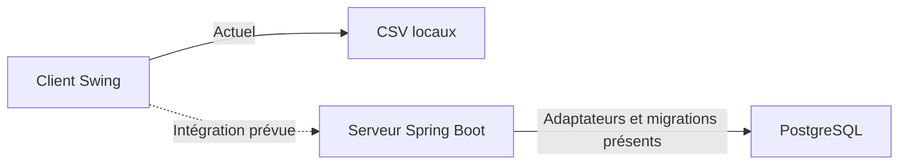

# Gestion+ · Serveur

**Le chantier backend de Gestion+, une application de gestion du personnel, des clients, des interventions et des remplacements.**

Gestion+ est un projet personnel de portfolio, développé progressivement pour approfondir Java, la conception d'une application de bureau et la construction d'un serveur sécurisé. Il est né d'un client Java Swing qui fonctionne aujourd'hui avec des fichiers CSV locaux. Ce dépôt prépare son évolution vers une architecture avec comptes, permissions et stockage centralisé.

> **En développement actif — version déclarée : 0.0.1-SNAPSHOT.**
> Les sources sont proposées pour découvrir le travail en cours. Le serveur ne fournit pas encore une application utilisable de bout en bout et n'est pas prêt pour un usage en entreprise ou une exposition sur Internet.

🚀 **[Télécharger et essayer la démo Windows](https://github.com/lisepinheiro2-lgtm/gestionplus-client/releases/tag/v0.1.0-demo)**
*Démonstration du client Swing avec données fictives et stockage CSV local, sans connexion au serveur.*

[Découvrir le client Swing](https://github.com/lisepinheiro2-lgtm/gestionplus-client) · [Avancement et feuille de route](docs/AVANCEMENT.md) · [Guide développeur](docs/DEVELOPPEMENT.md)

## Pourquoi un serveur ?

La cible est de centraliser les données et de vérifier l'identité et les droits de chaque utilisateur avant une opération. Le client présente les écrans ; le serveur porte les règles et les contrôles ; PostgreSQL conserve les données.

Le développement privilégie une séparation lisible entre métier, persistance et interface, ainsi que des validations progressives. La gestion complète des comptes et des permissions reste un chantier.

## Deux dépôts, deux fonctionnements à distinguer

| Élément | Fonctionnement actuel | Cible |
| --- | --- | --- |
| [Client Swing](https://github.com/lisepinheiro2-lgtm/gestionplus-client) | Application de bureau autonome avec CSV locaux. | Échanges avec le serveur pour l'utilisation connectée. |
| Ce serveur Spring Boot | Parcours HTTP de connexion/session et services métier de comptes, permissions et audit en développement. | Intégration complète des services avec Swing et API métier contrôlées. |
| PostgreSQL | Configuration locale et migrations présentes dans les sources ; état réel d'une base non déduit de ces fichiers. | Stockage du serveur, accessible par celui-ci. |

**Consulter ou récupérer ce dépôt ne rend pas Spring Boot obligatoire pour démarrer le client dans son fonctionnement autonome actuel.** Aucun démarrage automatique du serveur n'est ajouté au client. Cette autonomie de démonstration ne constitue pas une autorisation d'accéder hors ligne à des données d'entreprise : les contrôles de l'usage connecté doivent rester imposés côté serveur.

## Ce que l'on peut déjà examiner

- Les modèles de comptes, de credentials, de salariés et d'unités organisationnelles.
- Les services de comptes, d’invitations, de gouvernance, d’authentification et de changement de mot de passe.
- Les contrôles de rôles et de périmètres côté serveur, les sessions et le MFA TOTP.
- Les adaptateurs JPA/JDBC et les migrations V1 à V25 présentes dans les sources.
- L’audit transactionnel et son secours chiffré, les files d’envoi et les tests unitaires et PostgreSQL associés.

La présence d’une classe ou d’un test ne prouve pas qu’un parcours complet fonctionne. L’état ci-dessous décrit les sources locales au 11 novembre 2026 ; les autres pages de documentation conservent leur propre date.

## Accès HTTP présents dans les sources

État relu le **11 novembre 2026**. Les routes applicatives actuellement autorisées sont les suivantes :

| Méthode et chemin | Accès et comportement |
| --- | --- |
| `GET /api/auth/csrf` | Accessible sans connexion ; fournit le jeton CSRF et crée la session nécessaire. |
| `POST /login` | Formulaire `application/x-www-form-urlencoded` avec `username`, `password` et, lorsque requis, `totp`. Jeton CSRF obligatoire. Succès : 200 ; échec d’authentification : 401 générique. |
| `GET /api/auth/me` | Session authentifiée encore valide ; renvoie le nom d’utilisateur courant. |
| `GET /api/auth/session` | Session authentifiée ; renvoie `expiresAt` et `warnAt`. Cette consultation ne prolonge pas l’activité. |
| `POST /logout` | Jeton CSRF obligatoire ; déconnexion et réponse 204. |

La configuration `formLogin` conserve les pages HTML par défaut de Spring Security pour `GET /login` et la confirmation `GET /logout`. Ces pages ne constituent pas le parcours Swing avec MFA. Le traitement interne des erreurs servlet est autorisé ; les autres routes restent refusées par défaut.

Les services d’invitation, d’activation, d’enrôlement et récupération MFA, de changement de mot de passe et de gouvernance existent côté Java. **Leurs parcours HTTP publics et leur intégration Swing restent à construire.** Le traitement d’un conflit de nom à l’activation est préparé en 409 générique, sans détail sur un autre compte ; les autres contraintes PostgreSQL ne sont pas assimilées indistinctement à ce conflit.

## Migrations présentes et état de la base

Les sources contiennent **V1 à V25** :

| Versions | Objet |
| --- | --- |
| V1–V6 | Comptes, credentials, salariés et unités organisationnelles. |
| V7–V12 | Audit, structures et rôles locaux, unicité ADMIN, entreprises, appartenances administratives et métadonnées d’audit. |
| V13–V16 | Identité des comptes, association unique au salarié et périmètres des salariés/unités. |
| V17–V18 | Cohérence des appartenances entreprise/structure, version de session et responsabilités des managers. |
| V19–V21 | Files de notifications et invitations d’activation. |
| V22–V23 | Entreprise de l’audit, journal transactionnel chiffré, réintégration et facteurs TOTP/codes de récupération. |
| V24 | Contrôle des rattachements historiques et validation des contraintes ajoutées en V17. |
| V25 | Demandes durables d’envoi des invitations, états et nouvelles tentatives. |

La présence de ces fichiers **ne prouve pas leur application sur une base**. V24 refuse des rattachements historiques incohérents et n’invente aucun droit pour les réparer. L’état réel de Flyway, les sauvegardes et toute correction des données doivent être vérifiés sur la base explicitement choisie avant une montée de version. Les migrations déjà publiées ou appliquées ne sont pas réécrites.

## Protections implémentées et limites

- Autorisations côté serveur et isolation entreprise/structure, avec rôles courants relus et contrôle de la version de session.
- SECRETARY peut gérer les comptes EMPLOYEE et TEAM_LEAD autorisés de sa structure ; les comptes privilégiés et les autres périmètres restent protégés. Sa création de compte exige un salarié de la structure.
- SECURITY_OFFICER est déclaré et soumis au MFA. La décision du 11 novembre réserve sa nomination et ses rattachements au SUPER_ADMIN et prévoit la consultation d’audit par VIEW_AUDIT / VIEW_SENSITIVE_AUDIT dans son périmètre. Ces permissions et ces parcours ne sont pas encore implémentés.
- Argon2, espaces significatifs conservés dans le mot de passe, longueur de 12 à 128 caractères et contrôle des mots de passe compromis.
- TOTP avec anti-rejeu, secrets chiffrés par AES-GCM, codes de récupération stockés sous forme d’empreintes et révocation des sessions après validation des changements.
- Expiration après 30 minutes d’inactivité et 8 heures au maximum ; avertissement prévu deux minutes avant expiration, à raccorder à Swing.
- CSRF, erreurs publiques génériques, corps HTTP bornés même sans taille annoncée, limites de paramètres et refus par défaut.
- Audit structuré sans copie des arguments secrets ni des messages d’exception ; succès liés à la transaction métier, refus et échecs indépendants, secours chiffré durable et réconciliation.
- Envoi d’invitation à partir d’une demande validée en base. Après acceptation SMTP suivie d’un échec de finalisation, le même jeton est conservé pour reprise ; l’activation répond temporairement 503. SMTP peut produire un doublon lors d’une nouvelle tentative.
- Vérification des changements concurrents par verrous PostgreSQL et relecture de l’état avant opération. Un test de garde impose une revue lors de l’ajout d’une permission au catalogue ; il doit être exécuté avant intégration.

Les preuves d’identité d’activation, d’enrôlement MFA et de confirmation renforcée exigent encore leurs implémentations opérationnelles. La nomination ADMIN préparée pour un compte en attente, avec son délai de 24 heures, reste à réaliser. Les appareils de confiance, la récupération exceptionnelle SUPER_ADMIN, la gouvernance des contacts de récupération et le mode hors ligne `ADMIN_EMERGENCY` sur poste autorisé restent des chantiers distincts. Aucun compte administrateur ni secret de démonstration n’est fourni.

## Décisions fonctionnelles et réalisation

Les [contrats communs du 11 novembre](https://github.com/lisepinheiro2-lgtm/gestionplus-client/blob/main/docs/vision-ensemble.md#decisions-consolidees-2026-11-11) précisent les règles ; leur inscription ne vaut pas livraison.

- Protection du compte entier : les services appliquent la vérification des autres rôles à MANAGER et SECRETARY ; sa généralisation aux autres gestionnaires reste à corriger.
- Sessions : les désactivations, transferts et changements de secrets déclenchent une révocation. Tous les changements sensibles de droits ne la déclenchent pas encore, même si les droits sont relus côté serveur.
- Conservation des audits : durées par entreprise/catégorie, échéance initiale conservée et gel ciblé sont décidés ; politique, consultation autorisée et traitement du gel ne sont pas implémentés.
- Appareils de confiance : 24 h pour SUPER_ADMIN, 7 jours pour ADMIN/SECURITY_OFFICER, 14 jours pour R_H/MANAGER/SECRETARY ; exclus sur poste partagé. Aucun dispositif correspondant n’est livré.
- Consultation ordinaire hors ligne : lecture seule, poste autorisé, espace individuel chiffré, sept jours et verrouillage après 15 minutes ; non implémentée.
- ADMIN_EMERGENCY : deux postes par ADMIN, mot de passe et TOTP, sans durée fixe ; non implémenté. Sa révocation définitive interdit les modifications en attente. La récupération du travail de l’ancien ADMIN et la preuve de fraîcheur entre postes restent à clarifier.
- Notifications de correction, historique Swing, quarantaine et accusés en ligne avec blocage limité aux dépendances restent à construire.

Les services d’activation, MFA et gouvernance ne constituent pas des API métier disponibles : les accès HTTP effectifs restent ceux du tableau ci-dessus.

## Tests et niveau de preuve

| Élément | État disponible |
| --- | --- |
| Dernière capture globale communiquée | 530 tests exécutés dans Eclipse, 0 erreur et 1 échec dans le test de rollback du transfert ADMIN. Ce test a ensuite été corrigé ; aucune nouvelle suite verte n’est déduite de cette correction. |
| Tests dédiés de sécurité | `PasswordChangeServiceTest`, `MfaSecretCipherTest`, `MailAccountInvitationSenderTest` et `SuperAdminSuccessionServiceTest` rédigés. |
| Confidentialité et permissions | Tests de non-divulgation dans l’audit, les objets d’authentification et les erreurs ; garde du catalogue de permissions et des droits SECRETARY/SECURITY_OFFICER. |
| PostgreSQL | Scénarios rédigés de collisions de noms, activation contre expiration, rollback du changement de mot de passe et de la succession, en complément des tests de concurrence déjà présents. |
| Exécution de cette intervention | Aucun test, build, serveur ni migration lancé. Les nouveaux tests et corrections restent à compiler et à exécuter sur un environnement isolé explicitement autorisé. |

La relecture statique et la présence de tests ne constituent pas une validation applicative. Aucun résultat TLS réel, restauration de sauvegarde ou déploiement multi-instance n’est revendiqué.

## Configuration de production à fournir hors dépôt

Le profil `prod` active TLS, exige HTTPS et utilise des cookies `Secure`, `HttpOnly` et `SameSite=Lax`. Les en-têtes de proxy restent ignorés par défaut. Il faut fournir des certificats valides et vérifier leur confiance côté Swing.

| Paramètre | Exigence actuelle |
| --- | --- |
| `DB_USER`, `DB_PASSWORD` | Identité PostgreSQL du serveur, avec droits adaptés et sans accès direct depuis Swing. |
| `gestionplus.mfa.key` | Clé externe de 32 octets encodée en Base64. Le démarrage en profil `prod` échoue si elle manque ou si son format est invalide. Une clé bien formée doit aussi correspondre aux facteurs déjà chiffrés. |
| `gestionplus.audit.fallback.key` | Clé externe AES de 32 octets encodée en Base64 ; à conserver pour relire le secours et ses sauvegardes. |
| `gestionplus.audit.fallback.directory` | Répertoire existant, privé, persistant et accessible en écriture. Les ACL Windows et l’accès aux sauvegardes doivent être vérifiés lors de l’installation. |
| `gestionplus.activation.delivery-key` | Clé externe de 32 octets encodée en Base64, nécessaire à la préparation et à la reprise des invitations. Sa conservation est indispensable aux demandes en attente ; elle n’est pas exigée au démarrage actuellement. |
| Configuration SMTP et `gestionplus.notifications.from` | Nécessaires pour les envois effectifs ; transport, authentification et délais d’attente à configurer et vérifier. |
| `gestionplus.activation.link` | URL HTTPS sans identifiants, requête ni fragment préexistant. |
| Configuration SSL Spring Boot | Certificat et clé privée externes, via un bundle SSL ou les paramètres de magasin de clés adaptés au déploiement. |

Les clés MFA, d’audit et d’invitation ont des usages distincts. Elles ne doivent pas être placées dans les sources, exemples, journaux ou arguments visibles. Leur sauvegarde, leurs droits d’accès et leur restauration nécessitent une procédure d’exploitation. Le dépôt ne fournit aucune valeur de production.

## Conception technique et exploitation à préciser

Les [décisions consolidées du 11 novembre](https://github.com/lisepinheiro2-lgtm/gestionplus-client/blob/main/docs/vision-ensemble.md#decisions-consolidees-2026-11-11) fixent le blocage lors d’une panne HIBP et les objectifs de rotation MFA. Les mécanismes et garanties d’exploitation suivants restent à compléter :

| Sujet | État observé et options à décider |
| --- | --- |
| Have I Been Pwned indisponible | Décidé : bloquer création et changement de mot de passe avec explication dans Swing, sans contournement silencieux. Le service interrompt déjà l’opération par exception ; un code temporaire explicite et l’affichage Swing restent à réaliser. La connexion avec un mot de passe existant ne dépend pas de cet appel. Aucun fonctionnement permissif ou cache de substitution n’est activé. |
| Rotation des clés MFA | Décidé : rechiffrement transparent lors d’une rotation normale, sans réinscription. En cas de compromission : sessions révoquées, accès privilégiés concernés suspendus et nouvel enrôlement après vérification renforcée. Aucun de ces parcours de rotation/incident n’est implémenté. Le format actuel n’identifie pas une clé parmi plusieurs ; mécanisme de transition, conservation des anciennes clés et restauration restent à concevoir. Remplacer simplement la configuration rend les anciens facteurs illisibles. |
| Plusieurs instances | Sessions HTTP, registre de sessions et limitation des tentatives restent locaux. Une instance unique garde ces limites connues. L’affinité de session seule ne règle pas la limitation globale ni la reprise après panne. Un déploiement distribué demanderait sessions et registre partagés, compteurs atomiques communs, coordination des révocations, sérialisation du principal et des sessions, horloges cohérentes et traitement des journaux locaux. Les versions de session et compteurs TOTP PostgreSQL ne remplacent pas ces garanties. |
| Secrets et TLS | Options : variables d’environnement protégées, fichiers montés à accès restreint ou gestionnaire de secrets ; choisir sauvegarde, accès et renouvellement. La configuration actuelle termine TLS dans Spring Boot. Une terminaison par proxy demanderait une configuration explicite de confiance, du transport vers le serveur et de la validation côté Swing. Les traces HTTP détaillées, paramètres SQL et diagnostics SMTP doivent être examinés pour éviter toute fuite. |

Repères externes pour ces arbitrages : [API Pwned Passwords](https://haveibeenpwned.com/API/v3#PwnedPasswords), [gestion des clés OWASP](https://cheatsheetseries.owasp.org/cheatsheets/Cryptographic_Storage_Cheat_Sheet.html), [sessions Spring Security en environnement distribué](https://docs.spring.io/spring-session/reference/spring-security.html) et [configuration SSL Spring Boot](https://docs.spring.io/spring-boot/reference/features/ssl.html).

## Technologies déclarées

| Technologie | Rôle |
| --- | --- |
| Java 25 | Langage et niveau Java du projet. |
| Spring Boot 4.1.2 | Assemblage et démarrage du serveur. |
| Spring Security | Authentification HTTP, CSRF, sessions, refus par défaut et contrôles d’autorisation. |
| Spring Data JPA / Hibernate | Persistance et conversion entre objets Java et tables. |
| PostgreSQL / Flyway | Base relationnelle et évolution versionnée de son schéma. |
| Argon2 / Bouncy Castle 1.86 | Hachage des mots de passe. |
| Maven Wrapper, JUnit Jupiter, Mockito | Dépendances, construction et tests. |

Ces indications proviennent des fichiers du projet ; elles ne constituent pas une certification de compatibilité ni un résultat de build.

## Explorer le chantier

Pour une première lecture, commencer par [l'avancement](docs/AVANCEMENT.md), puis suivre les repères de code et les prérequis du [guide développeur](docs/DEVELOPPEMENT.md). Aucun identifiant de démonstration ni compte administrateur n'est fourni.

Les sources peuvent être publiées pendant le développement ; mettre un service en ligne demande une validation distincte de sa sécurité. Aucun badge de réussite globale des tests n'est affiché sans preuve.

## Documentation et réutilisation

- [Commencer ici : sommaire de la documentation](docs/index.md)
- [Vision d’ensemble Gestion+ et réunion future](https://github.com/lisepinheiro2-lgtm/gestionplus-client/blob/main/docs/vision-ensemble.md)
- [Avancement, preuves et prochaines étapes](docs/AVANCEMENT.md)
- [Exploration du code et exécution locale](docs/DEVELOPPEMENT.md)
- [Publication Git et travail sur deux ordinateurs](docs/PUBLICATION.md)

La licence propre au serveur reste à définir. Aucune licence du client n'est automatiquement appliquée à ce dépôt. Les dépendances conservent leurs licences respectives.
