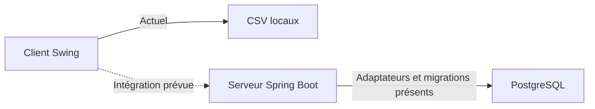

# Gestion+ · Serveur

**Le chantier backend de Gestion+, une application de gestion du personnel, des clients, des interventions et des remplacements.**

Gestion+ est un projet personnel de portfolio, développé progressivement pour approfondir Java, la conception d'une application de bureau et la construction d'un serveur sécurisé. Il est né d'un client Java Swing qui fonctionne aujourd'hui avec des fichiers CSV locaux. Ce dépôt prépare son évolution vers une architecture avec comptes, permissions et stockage centralisé.

> **En développement actif — version déclarée : 0.0.1-SNAPSHOT.**
> Les sources sont proposées pour découvrir le travail en cours. Le serveur ne fournit pas encore une application utilisable de bout en bout et n'est pas prêt pour un usage en entreprise ou une exposition sur Internet.

[Découvrir le client Swing](https://github.com/lisepinheiro2-lgtm/gestionRemplacement) · [Avancement et feuille de route](docs/AVANCEMENT.md) · [Guide développeur](docs/DEVELOPPEMENT.md)

## Pourquoi un serveur ?

La cible est de centraliser les données et de vérifier l'identité et les droits de chaque utilisateur avant une opération. Le client présente les écrans ; le serveur porte les règles et les contrôles ; PostgreSQL conserve les données.

Le développement privilégie une séparation lisible entre métier, persistance et interface, ainsi que des validations progressives. La gestion complète des comptes et des permissions reste un chantier.

## Deux dépôts, deux fonctionnements à distinguer

| Élément | Fonctionnement actuel | Cible |
| --- | --- | --- |
| [Client Swing](https://github.com/lisepinheiro2-lgtm/gestionRemplacement) | Application de bureau autonome avec CSV locaux. | Échanges avec le serveur pour l'utilisation connectée. |
| Ce serveur Spring Boot | Modèles, services et adaptateurs de persistance en développement ; toutes les requêtes HTTP sont refusées par la configuration actuelle. | API authentifiée, permissions, comptes et audit. |
| PostgreSQL | Configuration locale et migrations présentes dans les sources ; état réel d'une base non déduit de ces fichiers. | Stockage du serveur, accessible par celui-ci. |

**Consulter ou récupérer ce dépôt ne rend pas Spring Boot obligatoire pour démarrer le client dans son fonctionnement autonome actuel.** Aucun démarrage automatique du serveur n'est ajouté au client. Cette autonomie de démonstration ne constitue pas une autorisation d'accéder hors ligne à des données d'entreprise : les contrôles de l'usage connecté doivent rester imposés côté serveur.

## Ce que l'on peut déjà examiner

- Les modèles de comptes, de credentials, de salariés et d'unités organisationnelles.
- Le service d'authentification, le hachage Argon2 et une politique de mot de passe.
- Une première politique de rôles et de permissions, encore à raccorder aux opérations exposées.
- Les adaptateurs JPA, les repositories Spring Data et les migrations V1 à V6.
- Les premières pièces de l'audit et les tests écrits autour de plusieurs de ces blocs.

La présence d'une classe ou d'un test ne prouve pas qu'un parcours complet fonctionne. Le [suivi public](docs/AVANCEMENT.md) précise les limites, les résultats disponibles et les étapes restantes.

## Technologies déclarées

| Technologie | Rôle |
| --- | --- |
| Java 25 | Langage et niveau Java du projet. |
| Spring Boot 4.1.2 | Assemblage et démarrage du serveur. |
| Spring Security | Authentification et future application des autorisations HTTP. |
| Spring Data JPA / Hibernate | Persistance et conversion entre objets Java et tables. |
| PostgreSQL / Flyway | Base relationnelle et évolution versionnée de son schéma. |
| Argon2 / Bouncy Castle 1.86 | Hachage des mots de passe. |
| Maven Wrapper, JUnit Jupiter, Mockito | Dépendances, construction et tests. |

Ces indications proviennent des fichiers du projet ; elles ne constituent pas une certification de compatibilité ni un résultat de build.

## Explorer le chantier

Pour une première lecture, commencer par [l'avancement](docs/AVANCEMENT.md), puis suivre les repères de code et les prérequis du [guide développeur](docs/DEVELOPPEMENT.md). Aucun identifiant de démonstration ni compte administrateur n'est fourni.

Les sources peuvent être publiées pendant le développement ; mettre un service en ligne demande une validation distincte de sa sécurité. Aucun badge de réussite globale des tests n'est affiché sans preuve.

## Documentation et réutilisation

- [Commencer ici : sommaire de la documentation](docs/index.md)
- [Vision d’ensemble Gestion+ et réunion future](https://github.com/lisepinheiro2-lgtm/gestionRemplacement/blob/main/docs/vision-ensemble.md)
- [Avancement, preuves et prochaines étapes](docs/AVANCEMENT.md)
- [Exploration du code et exécution locale](docs/DEVELOPPEMENT.md)
- [Publication Git et travail sur deux ordinateurs](docs/PUBLICATION.md)

La licence propre au serveur reste à définir. Aucune licence du client n'est automatiquement appliquée à ce dépôt. Les dépendances conservent leurs licences respectives.